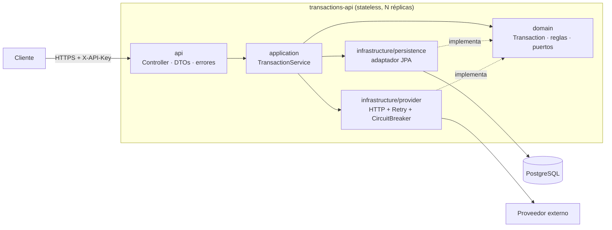
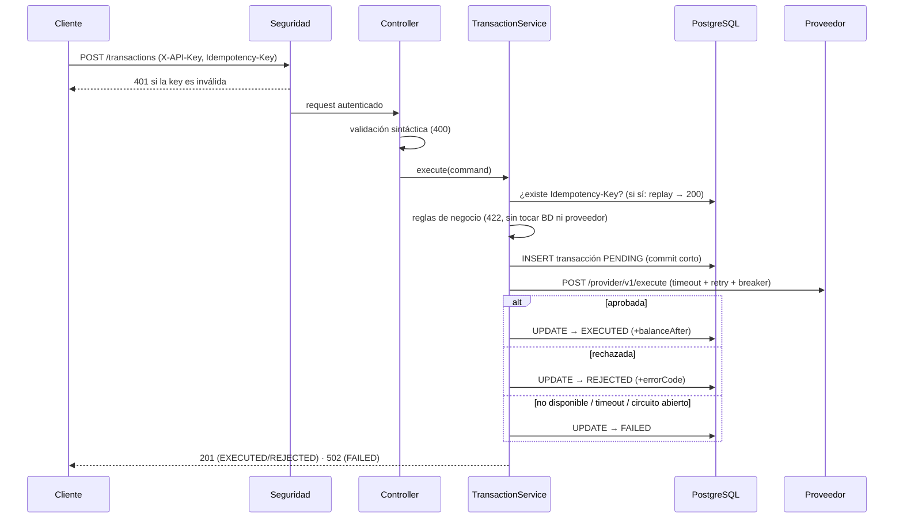
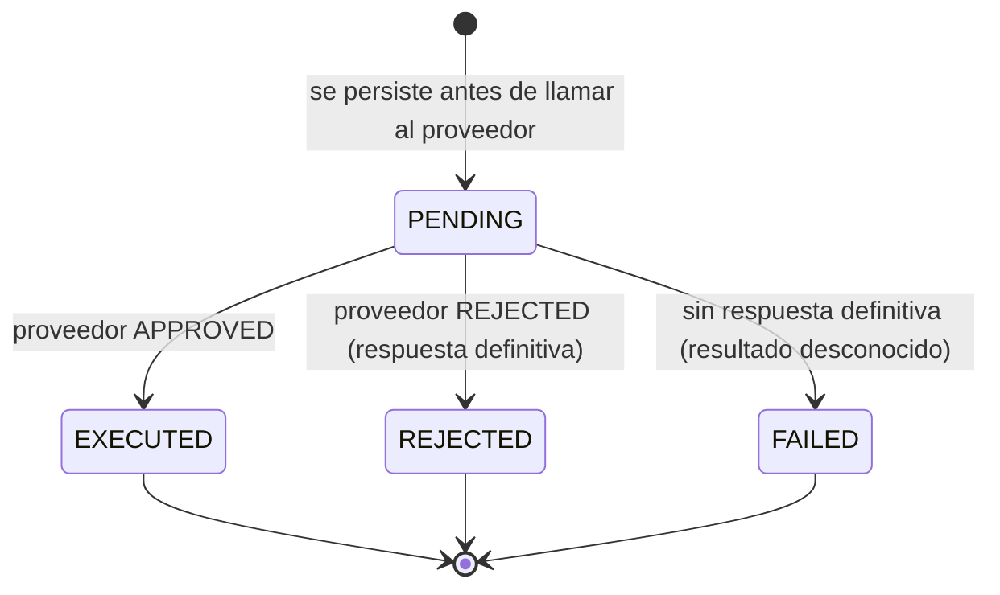

# Arquitectura y por qué de cada componente

## 1. Visión general

Regla de dependencias: **todo apunta hacia el dominio**. `domain` y `application` no importan Spring, JPA ni HTTP.
Se comprueba fácilmente: esos dos paquetes no importan nada de Spring y se prueban sin levantar el framework.

## 2. Flujo de `POST /transactions`

## 3. Estados de una transacción

`PENDING` que no avanza (proceso muerto) y `FAILED` son los dos estados que una conciliación debe revisar.

## 4. Componentes: qué hace cada uno y por qué existe

| Componente | Responsabilidad | Por qué así | Alternativa descartada |
|---|---|---|---|
| `domain/Transaction` (record inmutable) | Datos de la transacción y sus transiciones (`executed`, `rejected`, `failed`) | Inmutabilidad: no hay estados a medias ni efectos laterales; las transiciones son explícitas y testeables | Entidad JPA mutable con setters: mezcla persistencia con reglas |
| `domain/TransactionRules` | Monto mínimo, máximo de débito, solo MXN, máximo 2 decimales | Reglas puras y sin dependencias: se prueban en milisegundos y comunican la intención del negocio | Anotaciones de validación en el DTO: las reglas de negocio no son validación de formato |
| Puertos `TransactionRepository`, `ProviderGateway` | Contratos hacia afuera | Inversión de dependencias: el servicio no sabe si hay JPA, Mongo, HTTP o un fake | Inyectar `JpaRepository`/`RestClient` directo en el servicio |
| `application/TransactionService` | Orquesta el caso de uso | Una sola clase con el flujo completo y legible; **sin `@Transactional`** a propósito | `@Transactional` en el método: retendría una conexión del pool durante la llamada HTTP |
| `infrastructure/persistence` | Adaptador JPA, `Specification` para filtros, entidad separada del dominio | El dominio no se contamina con JPA; `Persistable` evita un SELECT innecesario antes de cada INSERT | Reusar el record como entidad |
| `infrastructure/provider/HttpProviderGateway` | Traduce el contrato HTTP del proveedor a `ProviderResult` | Aísla el formato del proveedor; distingue rechazo definitivo de indisponibilidad | Lanzar excepción por cada 4xx/5xx: mezclaría reglas de negocio con fallas técnicas |
| `ResilientProviderGateway` | `Retry( CircuitBreaker( HTTP ) )` | Decorador: la resiliencia se agrega sin tocar el adaptador ni el servicio; se prueba aislada | Anotaciones `@Retry/@CircuitBreaker` con AOP: orden implícito y fallbacks que pueden reintentarse |
| `MockProviderController` | Proveedor simulado con escenarios | Un solo proceso, sin dependencias, demuestra reintentos/timeouts/circuit breaker en vivo | WireMock: más pesado para correr el reto |
| `api/*` | HTTP: DTOs, códigos de estado, errores RFC 7807 | Contrato estable con `code` legible por máquinas | Mensajes de error libres |
| `infrastructure/security/*` | Autenticación por API key, deny-by-default | Mínimo suficiente para servicio-a-servicio (ver `SEGURIDAD.md`) | JWT/OAuth2 en el servicio: pertenece al gateway/IdP de la empresa |
| Flyway (`db/migration`) | Esquema versionado | Cambios reproducibles y revisables; Hibernate solo valida | `ddl-auto=update`: peligroso en producción |

## 5. Decisiones clave (en formato corto)

**D1 — Persistir `PENDING` antes de llamar al proveedor.**
*Contexto:* el proveedor mueve dinero y puede tardar o fallar. *Decisión:* guardar primero, actualizar después.
*Consecuencia:* nunca se pierde una transacción por una caída; cuesta un `UPDATE` extra por operación y obliga a
tener un proceso de conciliación para `PENDING`/`FAILED`.

**D2 — Idempotencia con `Idempotency-Key` + `UNIQUE`.**
*Contexto:* los clientes reintentan; en dinero, ejecutar dos veces es el peor error. *Decisión:* la restricción
de base de datos es el árbitro final (no un `if` en memoria), así funciona con N réplicas. *Consecuencia:* la
misma key con otro payload responde 409; una repetición responde 200 con la transacción original.

**D3 — Reintentar solo ante indisponibilidad, jamás ante rechazo.**
*Contexto:* `INSUFFICIENT_FUNDS` es una respuesta definitiva. *Decisión:* `REJECTED` es un valor de retorno, no una
excepción, así ni el retry ni el circuit breaker lo ven como falla. *Consecuencia:* un cliente con saldo bajo no
abre el circuito ni genera tráfico duplicado.

**D4 — Un timeout es `FAILED` con resultado desconocido, no "no se ejecutó".**
*Contexto:* el proveedor pudo procesar y la respuesta perderse. *Decisión:* enviar el `id` de la transacción como
`Idempotency-Key` al proveedor y registrar `FAILED`. *Consecuencia:* hace falta un job de conciliación que
consulte al proveedor (ver `OPERACION.md`).

**D5 — PostgreSQL.** Transaccional, con restricciones que sostienen la idempotencia, `NUMERIC` exacto para dinero,
índices para las consultas reales y camino de escalado claro. MongoDB habría sido válido pero el modelo es
relacional y la unicidad atómica es central.

**D6 — Paginación offset/limit con tope de 100.** Simple y lo que pide el reto. A cientos de millones de filas se
cambia a paginación por cursor (keyset); está documentado como siguiente paso.

## 6. Qué NO se hizo a propósito (pragmatismo)

- No hay broker de mensajes ni *outbox* todavía: se explica en `OPERACION.md` cuándo añadirlos.
- No hay CQRS ni microservicios internos: un servicio con puertos bien definidos ya permite crecer.
- No hay cache: las consultas pasan por índices y los datos cambian poco tras el estado final.
